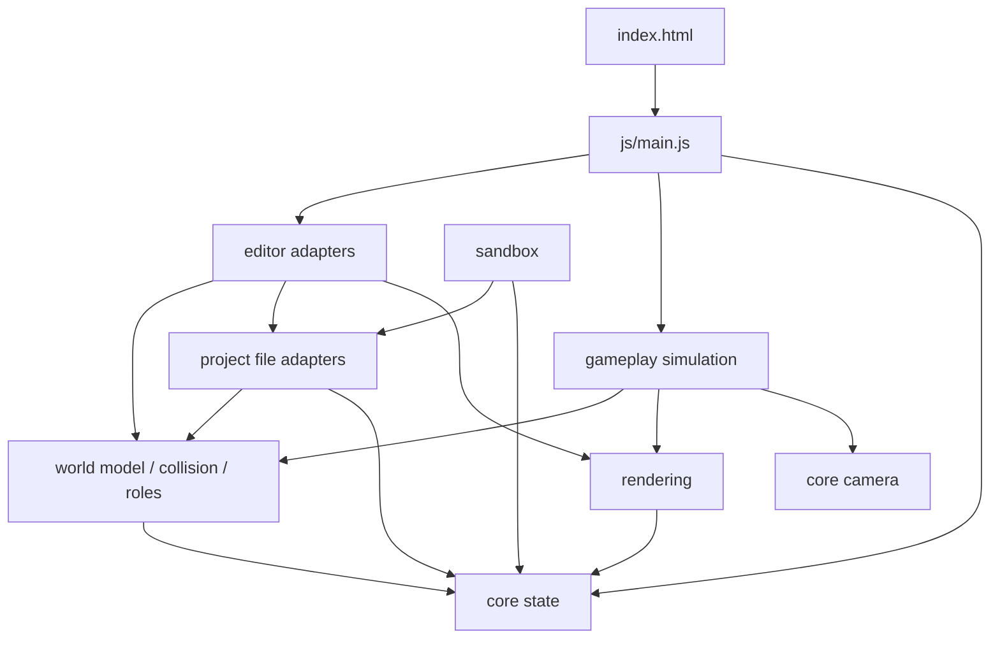

# Dependency Map — IsoPlayground

Dokumen ini menggambarkan arsitektur **yang sekarang aktif**. Function Map tetap menyimpan inventaris fungsi dari kode monolitik sebagai referensi historis; untuk lokasi implementasi terbaru, gunakan tabel pada dokumen ini.

## 1. Gambaran sistem



`index.html` memuat satu entry point, `js/main.js`, sebagai ES Module. Semua kode aplikasi memakai `import`/`export`; tidak ada lagi daftar classic script maupun `legacyBridge.js` sebagai jalur transisi. Event UI memakai atribut `data-ip-event-*` dan dispatcher dengan action map eksplisit.

## 2. Peta kepemilikan modul

| Folder / file | Tanggung jawab | Batas yang dijaga |
|---|---|---|
| `core/config.js` | Konstanta proyeksi, arah, sprite, NPC, Sandbox | Nilai dasar; bukan state runtime |
| `core/state.js` | `IPState` dan `isSandboxMode()` | Satu sumber state runtime |
| `core/coordinates.js`, `directions.js` | World/screen mapping dan vektor arah | Perhitungan murni berbasis state/config |
| `core/camera.js` | Follow, zoom, pan, world offset | Tidak mengakses DOM; render lewat callback |
| `core/textUtils.js` | Escape HTML untuk teks dinamis | Helper murni, tanpa DOM |
| `world/worldConfig.js` | Normalisasi ukuran dunia | Aturan ukuran world dipakai editor dan parser |
| `world/objects.js` | Operasi record objek: create, rename, duplicate, remove, role constraint | Model data; tidak merender atau mengakses DOM |
| `world/objectQueries.js` | Query nama, occupancy, posisi duplicate/spawn | Pencarian world |
| `world/collision.js` | Batas, footprint, point/path collision, move, clamp, overlap repair | Aturan ruang dan perpindahan |
| `world/roles.js` | Default Player/NPC/default, speed, runtime NPC | Aturan role dan inisialisasi |
| `gameplay/combat.js` | HP, damage, cooldown, knockback, Player attack | Aturan combat; render lewat callback |
| `gameplay/npcPathfinding.js`, `npcMovement.js`, `npc.js` | Grid NPC, A*, arah 8-way, attack stand point, waypoint movement; `npc.js` menjadi public barrel | Navigasi NPC; bukan DOM |
| `gameplay/playerSimulation.js`, `npcSimulation.js` | Fase pergerakan Player/knockback dan perilaku NPC/combat | Update per actor |
| `gameplay/animationSimulation.js` | Transisi animasi runtime dan preview tick | Update animasi per frame |
| `gameplay/runtimeMonitor.js` | Pengukur frame dan snapshot perubahan Sandbox | Callback resize dipasang browser host |
| `gameplay/simulation.js` | Urutan fase `requestAnimationFrame` | Orkestrasi; sinkronisasi UI melalui callback |
| `rendering/spriteAssets.js` | Pembuatan record gambar dan load callback | Asset tidak mengimpor renderer |
| `rendering/sprites.js` | Frame map, state/direction, FPS, resolver, cache | Data/animasi sprite; tanpa FileReader/DOM |
| `rendering/renderGeometry.js` | Cube faces, sprite bounds, polygon geometry | Perhitungan geometri tanpa Canvas state |
| `rendering/hitTesting.js` | Pointer hit testing objek | Memakai geometri dan resolusi sprite |
| `rendering/worldLayer.js` | Background plane, grid, dan axis | Lapisan dasar sebelum entity |
| `rendering/objectRenderer.js` | Sprite atau cube untuk setiap objek | Hanya representasi entity |
| `rendering/gameplayOverlays.js` | Radius, label, HP bar, damage popup, alert NPC | Lapisan indikator di atas entity |
| `rendering/renderer.js` | Context Canvas, visual signature, urutan layer dan redraw | Mengorkestrasi layer gambar |
| `editor/eventBridge.js` | Delegated events, parser argumen, action map | Hanya aksi whitelist; tanpa eval/function constructor |
| `editor/canvasHost.js` | Canvas/browser pointer/resize | Browser adapter dan pemasangan callback host |
| `editor/input.js` | Keyboard, shortcuts, drag/selection lifecycle | Adapter input browser |
| `editor/domUtils.js` | Melepas fokus kontrol DOM | Browser-only utility |
| `editor/objectEditor.js`, `editor/editorMenus.js` | Operasi editor, daftar, selection, menu konteks | Menghubungkan UI ke model world |
| `editor/objectIdentity.js`, `objectStats.js` | Input nama/role/collision dan statistik inspector | Adapter properti objek |
| `editor/inspector.js`, `spriteInspector.js` | Inspector objek dan preview sprite | Sinkronisasi DOM dan tampilan preview |
| `editor/spriteFileAdapter.js`, `spriteCycleImporter.js` | Upload dan batch import file sprite | Pembacaan file browser |
| `editor/commandConsole.js`, `commands.js` | UI console dan parser command | Command memanggil API model/gameplay |
| `editor/editorUI.js`, `engine.js` | Panel shell dan pemasangan browser adapters | UI shell; `engine.js` hanya coordinator tipis |
| `io/projectSerializer.js`, `projectParser.js`, `projectIO.js` | Serialize, parse, normalize dan public API I/O | Parser tidak commit state; serializer tidak menulis file |
| `io/projectRuntimeAdapter.js` | Commit snapshot ke state dan sinkronisasi UI | Batas antara data parsed dan runtime aktif |
| `io/projectFileAdapter.js`, `imageExport.js` | File picker/download JSON dan PNG | Browser file API |
| `sandbox/sandbox.js`, `sandboxStorage.js` | Payload sesi, buka tab, restore, IndexedDB/sessionStorage | Lifecycle sesi Sandbox |
| `main.js` | Entry point dan composition root | Menghubungkan callback antar-layer dan memulai loop |

## 3. Aturan dependency

1. `core` tidak mengimpor `editor`, `io`, atau `sandbox`.
2. `world` boleh mengimpor `core`, tetapi tidak mengimpor renderer/editor.
3. `gameplay` boleh memakai `core` dan `world`; DOM hanya di browser adapters.
4. `rendering` membaca state dan model, tetapi tidak memanggil editor. Asset load/redraw menggunakan callback yang dipasang host.
5. `editor` menjadi adapter untuk DOM, Canvas host, dan input. Ia boleh memakai world/gameplay/rendering, bukan sebaliknya.
6. `io` memisahkan parser/serializer dari file picker dan commit runtime.
7. `main.js` adalah composition root: tempat callback lintas-layer disambungkan dan requestAnimationFrame dijadwalkan. `gameplay/simulation.js` hanya memperbarui satu frame dan tidak menjadwalkan browser loop. Hindari membuat callback silang baru yang tidak dipasang dari sini/host.

## 4. Callback yang sengaja dipakai

Beberapa sistem memerlukan respons dari layer lain tanpa mengimpor implementasinya langsung:

- `setCameraRenderCallback()` — camera meminta redraw; callback dipasang oleh `canvasHost.js`.
- `setSpriteAssetRenderCallback()` — gambar yang selesai dimuat meminta redraw; callback dipasang oleh browser host.
- `setRuntimeCanvasResizeCallback()` — runtime monitor meminta resize; fungsi resize dipasang dari Canvas host.
- `setSimulationUiCallbacks()` — loop simulasi meminta pembaruan koordinat footer; UI callback disediakan oleh `main.js`.
- `setRendererAfterRenderCallback()` — renderer memberi kesempatan UI menyinkronkan nilai zoom setelah frame gambar.

Callback tersebut adalah dependency injection sederhana: modul menerima fungsi yang dibutuhkannya tanpa mengimpor layer pemilik fungsi itu.

## 5. Alur data utama

```text
Pengguna
  ├─ event/keyboard/pointer -> editor adapters
  │                            ├─ world model + collision
  │                            ├─ project/sandbox adapters
  │                            └─ camera + renderer
  │
  └─ requestAnimationFrame -> gameplay/simulation
                                ├─ player simulation
                                ├─ NPC simulation + combat
                                ├─ animation update
                                └─ redraw renderer

IPState -> dibaca oleh world, gameplay, rendering, editor, dan I/O
```

## 6. Catatan migrasi dan testing

- Event inline HTML telah dimigrasikan ke `data-ip-event-*`; dispatcher memakai object action whitelist.
- ES Modules sudah menjadi satu-satunya sistem pemuatan source. `index.html` hanya memuat `main.js`.
- Pemisahan kode dan pengujian sengaja dipisahkan dalam workflow. Pengujian menyeluruh (termasuk browser regression) dilakukan setelah seluruh pemisahan modul selesai.
- Diagram ini adalah peta arsitektural yang dipelihara manual, bukan hasil auto-generated call graph.
